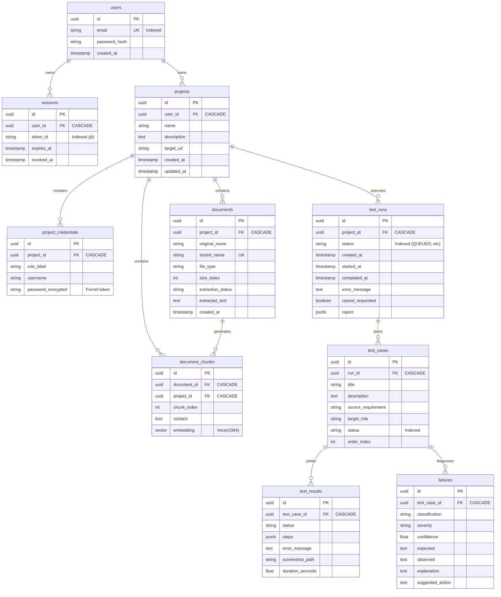
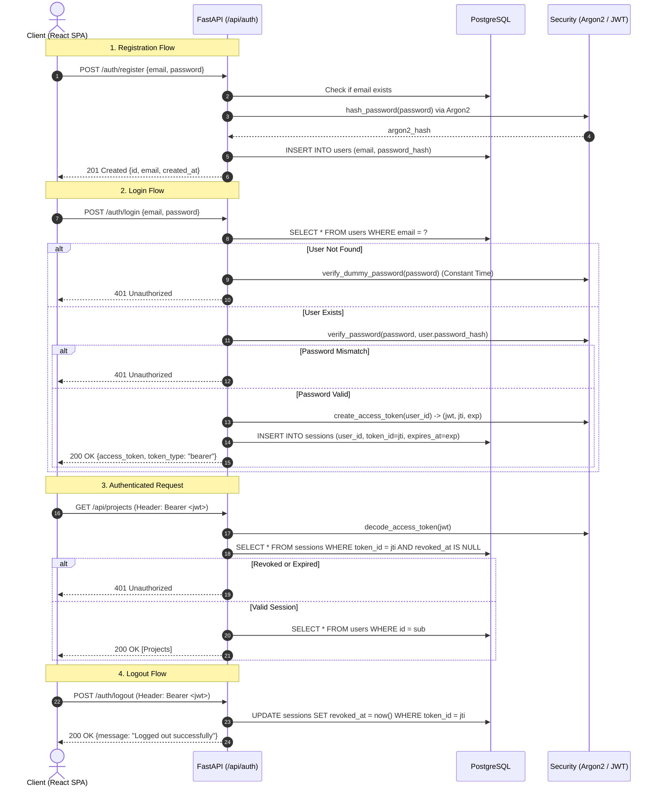
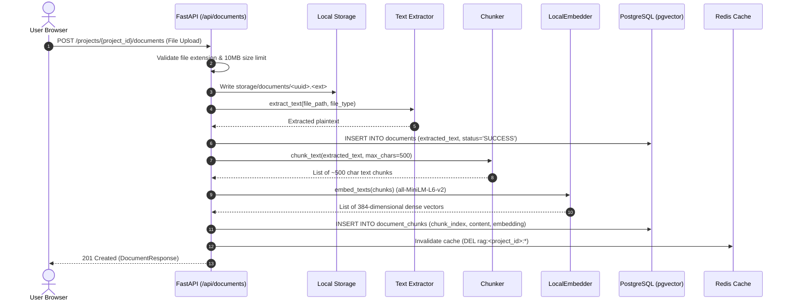
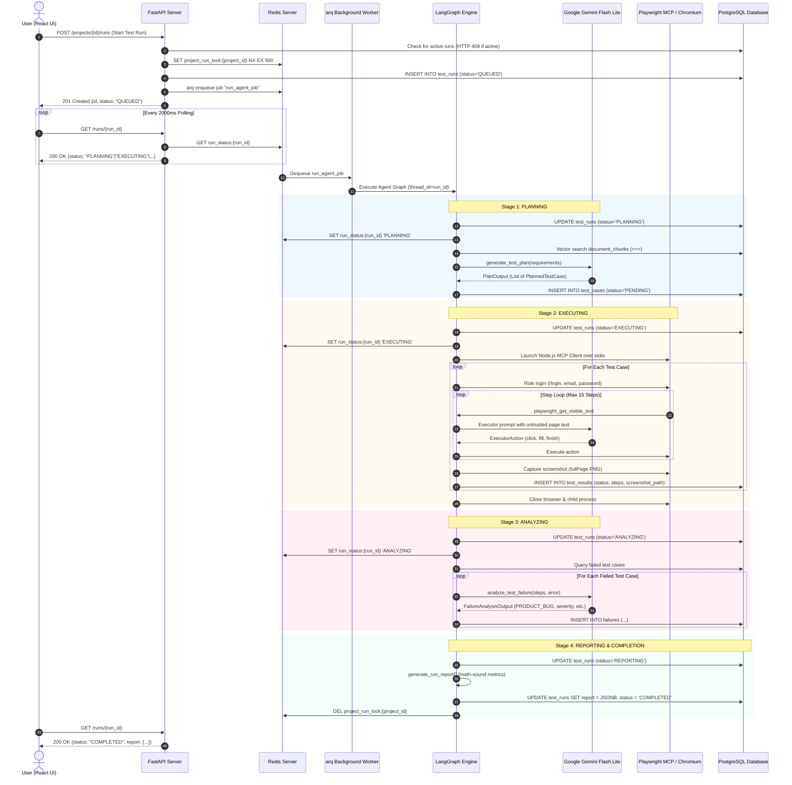

# TestPilot AI System Architecture & Engineering Review

This document provides a complete, developer-level architecture review of the **TestPilot AI** repository. Every assertion, state transition, and diagram in this document is directly grounded in the repository's active Python and JavaScript/React source code, Alembic migrations, and database schemas.

---

## 1. Executive Summary & Capabilities

### 1.1 What This Project Is
**TestPilot AI** is an automated web application quality assurance platform. It accepts uploaded software requirements specifications (in `.txt`, `.md`, `.pdf`, `.docx`, or `.json` formats), securely stores target web application credentials, and orchestrates an autonomous AI agent to:
1. Index and retrieve relevant requirement chunks via semantic vector search (`pgvector`).
2. Synthesize structured end-to-end browser test cases strictly citing requirement identifiers (e.g., `REQ-AUTH-01`).
3. Execute those test cases inside a sandboxed headless browser using Playwright over the Model Context Protocol (MCP).
4. Evaluate failed test cases using an AI Failure Analyst to classify root causes into 5 standard categories (`PRODUCT_BUG`, `TEST_FAILURE`, `AUTHENTICATION_FAILURE`, `ENVIRONMENT_FAILURE`, `FLAKY_TEST`).
5. Capture screenshot evidence for each test scenario.
6. Generate math-sound executive reports with failure breakdowns, pass rates, and recommended remediations.

### 1.2 Target Audience & Users
- **QA Engineers & Test Leads**: Teams seeking to turn PRDs into executable end-to-end browser regression suites without manually scripting Selenium/Cypress tests.
- **Developers & Product Managers**: Teams wanting automated acceptance testing and independent verification of bug tickets against specification documents.

### 1.3 Concrete Capabilities & Limits
| What TestPilot AI Can Do | Explicit Limits (What It Cannot Do) |
|---|---|
| Ingest multi-format documents and chunk them with dense vector embeddings (384-dim). | Cannot test native desktop or mobile applications (browser web apps only). |
| Plan deterministic test cases citing specific requirement IDs with target roles. | Cannot execute multi-user concurrent or load testing (strictly 1 test case at a time). |
| Execute browser actions (navigate, fill, click, select, press key) via Playwright MCP. | Cannot bypass CAPTCHAs, bot protection (Cloudflare Turnstile), or multi-factor SMS/TOTP. |
| Automatic role login for `admin` and `agent` roles using encrypted stored credentials. | Hardcodes `/login` form structure (`#email`, `#password`, `submit`) during pre-test login. |
| Classify defects with severity and confidence scores and capture PNG screenshots. | Cannot automatically generate code pull requests or patch the target application code. |
| Resume or inspect graph state via PostgreSQL checkpointer. | Cannot run parallel test executions on a single host (limited by 8 GB RAM budget D-018). |

---

## 2. Repository Map

```text
testpilot/
├── backend/                  # FastAPI REST API, SQLAlchemy models, and arq task worker
│   ├── app/
│   │   ├── agent/            # LangGraph orchestration, prompts, planner, executor, analyst, report, MCP client
│   │   ├── api/              # FastAPI APIRouters (auth, projects, documents, runs, health, deps)
│   │   ├── core/             # Config, database engine, Redis client, security (Argon2/Fernet), rate limiting, SSRF validator
│   │   ├── models/           # SQLAlchemy Declarative models (user, session, project, credential, document, chunk, test_run)
│   │   ├── schemas/          # Pydantic v2 request/response validation schemas
│   │   ├── services/         # Business logic (auth, projects, documents, RAG, chunker, embedder, storage, runs)
│   │   └── worker/           # arq worker settings, tasks, and __main__.py CLI entrypoint
│   ├── migrations/           # Alembic database migrations (versions 0cfe244ca2d8 through fb153e7a31a1)
│   ├── scripts/              # Database seeding scripts (seed_demo.py)
│   ├── storage/              # Local disk storage for uploaded documents and execution screenshots
│   ├── tests/                # 21 pytest test suites covering auth, security, SSRF, RAG, agent foundation, and worker
│   ├── pyproject.toml        # Backend dependencies managed via astral-sh/uv
│   └── uv.lock               # Deterministic dependency lockfile
├── frontend/                 # React 19 Single Page Application built with Vite and Tailwind CSS
│   ├── src/
│   │   ├── api/              # Fetch API client with automatic Bearer token injection and 401 redirect handling
│   │   ├── components/       # UI components (Navbar, StageStepper, CredentialDialog, ProjectDialog, ScreenshotViewer, Banner)
│   │   ├── context/          # React AuthContext managing user session state and localStorage token persistence
│   │   ├── hooks/            # Custom hooks (useRunStatus polling hook with 2000ms cadence)
│   │   ├── pages/            # View pages (Login, Register, Dashboard, ProjectPage, TestRunPage, ReportPage)
│   │   ├── App.jsx           # React Router route definitions and protected route wrappers
│   │   └── index.css         # Tailwind directives and application theme design tokens
│   ├── package.json          # Node dependencies (Vite, React, React Router, Lucide icons, Tailwind)
│   └── vite.config.js        # Vite configuration with proxy settings
├── supportdesk/              # Demo target web application with 3 planted defects toggled via environment variable
│   ├── app/
│   │   ├── config.py         # SupportDesk configuration and SUPPORTDESK_DEFECTS toggle property
│   │   ├── database.py       # SQLite database initialization and demo seed data (users, tickets)
│   │   └── main.py           # FastAPI application serving server-rendered HTML UI and REST endpoints
│   ├── pyproject.toml        # SupportDesk dependencies (FastAPI, uvicorn, pydantic-settings)
│   └── supportdesk.db        # SQLite database file storing demo tickets and users
├── mcp/                      # Model Context Protocol child process dependencies
│   ├── package.json          # Node configuration pinning @executeautomation/playwright-mcp-server@1.0.12
│   └── node_modules/         # Installed Playwright MCP server JavaScript bundle
├── docs/                     # Project specifications, architecture plans, decisions, security review, and final report
│   ├── architecture/         # System architecture documentation (ARCHITECTURE.md, ENDPOINTS.md, README.md)
│   ├── plans/                # Step-by-step phased execution plans
│   ├── DECISIONS.md          # Architectural Decision Records (D-001 through D-020)
│   ├── PRD.md                # Product Requirements Document
│   ├── SECURITY.md           # Security architecture, threat modeling, and defensive controls
│   └── FINAL_REPORT.md       # Project delivery report, verification receipts, and demo walkthrough
├── .env                      # Application environment configuration (uncommitted; gitignored)
├── .env.example              # Template environment configuration file
└── SUPPORTDESK_REQUIREMENTS.md # Ground-truth system requirements specification for SupportDesk demo
```

---

## 3. Runtime Topology

### 3.1 Processes and Services
When TestPilot AI is fully operational, five distinct runtime processes interact:

1. **FastAPI Backend Server (`uvicorn app.main:app --port 8000`)**:
   - Python 3.12 process running Uvicorn on port `8000`.
   - Handles REST API requests, validates JWTs, encrypts credentials, validates target URLs against SSRF, ingests files, and serves screenshot evidence.
2. **arq Background Worker (`python -m app.worker` / `arq app.worker.WorkerSettings`)**:
   - Python 3.12 process managed by `arq`.
   - Connects to Redis (`6379`), dequeues `run_agent_job`, initializes the LangGraph agent graph, and executes planning, execution, failure analysis, and reporting.
   - Enforces `max_jobs = 1` concurrency to respect the host memory budget.
3. **Playwright MCP Server Child Process (`node mcp/.../dist/index.js`)**:
   - Node.js child process spawned over `stdio` by the arq worker via [app/agent/mcp_client.py:PlaywrightMCPClient](file:///c:/dev/testpilot/backend/app/agent/mcp_client.py#L54).
   - Manages headless Chromium browser instances, executes browser actions (navigate, fill, click), and captures PNG screenshots.
4. **Vite Frontend Server (`npm run dev`)**:
   - Node.js dev server listening on port `5173`.
   - Serves the React 19 Single Page Application.
5. **SupportDesk Target App (`uvicorn app.main:app --port 8001`)**:
   - Python 3.12 process running on port `8001`.
   - Provides the target customer support CRM with SQLite storage and 3 planted defects.
6. **PostgreSQL Database (`localhost:5432`)**:
   - Local Windows PostgreSQL 18 service with `pgvector` extension enabled.
   - Hosts tables for users, sessions, projects, credentials, documents, vector chunks, test runs, test cases, results, and failures. Also hosts LangGraph checkpoint tables.
7. **Redis Server (`localhost:6379`)**:
   - Redis server running inside WSL2 Ubuntu, exposed to Windows host on port `6379`.
   - Acts as arq job queue, duplicate run lock (`project_run_lock`), cancel flag store (`run_cancel`), run status cache (`run_status`), and RAG query cache (`rag:`).
8. **External LLM Providers**:
   - Primary: **Google AI Studio** (`ChatGoogleGenerativeAI` via `https://generativelanguage.googleapis.com`).
   - Fallback: **OpenRouter** (`ChatOpenAI` via `https://openrouter.ai/api/v1`).

### 3.2 Component Architecture Diagram

```mermaid
flowchart TB
    subgraph Client["User Browser"]
        SPA["TestPilot React SPA\n(Port 5173)"]
    end

    subgraph Host["Windows Host Services"]
        API["FastAPI Backend API\n(Port 8000)"]
        WORKER["arq Task Worker\n(max_jobs = 1)"]
        TARGET["SupportDesk CRM\n(Port 8001)"]
        PG[("PostgreSQL 18 + pgvector\n(Port 5432)")]
        DISK["Local Storage\n(/storage/documents, /storage/screenshots)"]
    end

    subgraph WSL["WSL2 Ubuntu"]
        REDIS[("Redis Server\n(Port 6379)")]
    end

    subgraph ChildProc["Worker Subprocess (stdio)"]
        MCP["Playwright MCP Server\n(Node.js / index.js)"]
        CHROME["Headless Chromium"]
    end

    subgraph Cloud["External AI APIs"]
        GEMINI["Google AI Studio\n(Gemini Flash Lite)"]
        OPENROUTER["OpenRouter API\n(Fallback LLM)"]
    end

    SPA -->|REST / JSON (JWT)| API
    SPA -.->|Polls status (2s)| API

    API -->|Read/Write Models| PG
    API -->|Files & Evidence| DISK
    API -->|Acquire lock / Enqueue job| REDIS
    API -.->|SSRF validation check| TARGET

    REDIS -->|Dequeue run_agent_job| WORKER
    WORKER -->|Status & Checkpoints| PG
    WORKER -->|Status Pub/Cache| REDIS
    WORKER -->|Stdio JSON-RPC 2.0| MCP
    MCP -->|Drives automation| CHROME
    CHROME -->|HTTP Requests| TARGET
    CHROME -->|Saves screenshots| DISK

    WORKER -->|Primary structured calls| GEMINI
    WORKER -.->|On 429/timeout fallback| OPENROUTER
```

---

## 4. Configuration Audit

All configuration is centralized in [backend/app/core/config.py](file:///c:/dev/testpilot/backend/app/core/config.py) using `pydantic-settings` (`BaseSettings`). Settings load from `.env` located at the repository root (`ROOT_DIR / ".env"`).

### 4.1 Environment Variables
| Variable Name | Required | Default Value | Validation Rule | Code Location |
|---|---|---|---|---|
| `DATABASE_URL` | **Yes** | None (Ellipsis `...`) | Must be valid asyncpg connection string (`postgresql+asyncpg://...`) | [config.py:L24](file:///c:/dev/testpilot/backend/app/core/config.py#L24) |
| `TEST_DATABASE_URL` | No | `""` | Connection string for isolated test database (`testpilot_test`) | [config.py:L25](file:///c:/dev/testpilot/backend/app/core/config.py#L25) |
| `REDIS_URL` | No | `"redis://localhost:6379/0"` | Redis connection URL | [config.py:L28](file:///c:/dev/testpilot/backend/app/core/config.py#L28) |
| `JWT_SECRET` | **Yes** | None (Ellipsis `...`) | Custom validator: string length must be **>= 32 characters** | [config.py:L29, L38-L43](file:///c:/dev/testpilot/backend/app/core/config.py#L29) |
| `JWT_EXPIRE_MINUTES` | No | `60` | Integer expiration window for user JWT sessions | [config.py:L30](file:///c:/dev/testpilot/backend/app/core/config.py#L30) |
| `CREDENTIAL_ENCRYPTION_KEY` | No | `""` | Must be a 32-byte url-safe base64-encoded Fernet key | [config.py:L31](file:///c:/dev/testpilot/backend/app/core/config.py#L31) |
| `STORAGE_DIR` | No | `"./storage"` | Filesystem directory for documents and screenshots | [config.py:L32](file:///c:/dev/testpilot/backend/app/core/config.py#L32) |
| `MAX_UPLOAD_MB` | No | `10` | Maximum upload size in megabytes | [config.py:L33](file:///c:/dev/testpilot/backend/app/core/config.py#L33) |
| `ALLOWED_PRIVATE_HOSTS` | No | `"localhost,127.0.0.1"` | Parsed into list of hostnames permitted past SSRF firewall | [config.py:L34, L74-L79](file:///c:/dev/testpilot/backend/app/core/config.py#L34) |
| `GOOGLE_API_KEY` | No | `""` | Google AI Studio API key | [config.py:L46](file:///c:/dev/testpilot/backend/app/core/config.py#L46) |
| `GOOGLE_MODEL` | No | `"gemini-2.5-flash"` | Primary Gemini model ID | [config.py:L47](file:///c:/dev/testpilot/backend/app/core/config.py#L47) |
| `GOOGLE_FALLBACK_MODEL` | No | `""` | Secondary fallback Gemini model ID | [config.py:L48](file:///c:/dev/testpilot/backend/app/core/config.py#L48) |
| `OPENROUTER_API_KEY` | No | `""` | OpenRouter API authentication key | [config.py:L49](file:///c:/dev/testpilot/backend/app/core/config.py#L49) |
| `OPENROUTER_MODEL` | No | `""` | OpenRouter fallback model ID (e.g. `nvidia/nemotron-...`) | [config.py:L50](file:///c:/dev/testpilot/backend/app/core/config.py#L50) |
| `LLM_MAX_RETRIES` | No | `3` | Maximum retry attempts for transient LLM provider failures | [config.py:L51](file:///c:/dev/testpilot/backend/app/core/config.py#L51) |
| `LLM_REQUESTS_PER_MINUTE` | No | `15` | Client-side rate limiter request cap per minute | [config.py:L52](file:///c:/dev/testpilot/backend/app/core/config.py#L52) |
| `EMBEDDING_MODEL` | No | `"sentence-transformers/all-MiniLM-L6-v2"` | HuggingFace embedding model ID | [config.py:L55](file:///c:/dev/testpilot/backend/app/core/config.py#L55) |
| `EMBEDDING_DIM` | No | `384` | Dimension of embedding vectors | [config.py:L58](file:///c:/dev/testpilot/backend/app/core/config.py#L58) |
| `MAX_TESTS_PER_RUN` | No | `8` | Maximum planned test cases per run | [config.py:L61](file:///c:/dev/testpilot/backend/app/core/config.py#L61) |
| `MAX_STEPS_PER_TEST` | No | `15` | Step budget per test case before forcing failure | [config.py:L62](file:///c:/dev/testpilot/backend/app/core/config.py#L62) |
| `TEST_TIMEOUT_SECONDS` | No | `120` | Execution timeout in seconds per individual test case | [config.py:L63](file:///c:/dev/testpilot/backend/app/core/config.py#L63) |
| `RUN_TIMEOUT_SECONDS` | No | `900` | Global timeout in seconds for entire test run | [config.py:L64](file:///c:/dev/testpilot/backend/app/core/config.py#L64) |
| `SUPPORTDESK_URL` | No | `"http://localhost:8001"` | Target URL for demo SupportDesk application | [config.py:L67](file:///c:/dev/testpilot/backend/app/core/config.py#L67) |
| `SUPPORTDESK_DEFECTS` | No | `"on"` | Defect toggle switch (`"on"` or `"off"`) | [config.py:L68](file:///c:/dev/testpilot/backend/app/core/config.py#L68) |

---

## 5. Data Model & Storage Partitioning

### 5.1 Storage Partitioning Strategy
- **PostgreSQL (`testpilot`)**: Source of truth for all relational models, user accounts, project metadata, encrypted credentials, document records, vector embeddings (`pgvector`), test cases, results, and LangGraph workflow checkpoints.
- **Redis (`db 0`)**: Ephemeral operational cache. Holds `project_run_lock:{project_id}` (900s TTL), `run_cancel:{run_id}` (900s TTL), transient `run_status:{run_id}` stage updates, `rag:{project_id}:{query_hash}` search results (3600s TTL), rate limiting fixed-window counters, and `arq` task queue entries.
- **Local Filesystem (`storage/`)**: Static binary artifacts. Raw uploaded requirements files stored in `storage/documents/{stored_name}` and execution screenshots stored in `storage/screenshots/{run_id}/{test_case_id}.png`.

### 5.2 Entity Relationship Diagram



### 5.3 Alembic Migration History
Located in [backend/migrations/versions/](file:///c:/dev/testpilot/backend/migrations/versions/):
1. `3ef571d8a202_enable_vector_extension.py`: Executes `CREATE EXTENSION IF NOT EXISTS vector`.
2. `d3d1ca663a5d_create_users_and_sessions_tables.py`: Creates `users` and `sessions` with foreign keys and unique indexes.
3. `0cfe244ca2d8_create_projects_and_credentials_tables.py`: Creates `projects` and `project_credentials` tables.
4. `7e0d9c8a3260_create_documents_table.py`: Creates `documents` table with `stored_name` uniqueness.
5. `99562a345769_create_document_chunks_table.py`: Creates `document_chunks` table with `embedding vector(384)` column.
6. `fb153e7a31a1_create_test_runs_tables.py`: Creates `test_runs`, `test_cases`, `test_results`, and `failures` tables with cascade deletes.

---

## 6. API Reference (`ENDPOINTS.md`)
*See the companion file [ENDPOINTS.md](file:///c:/dev/testpilot/docs/architecture/ENDPOINTS.md) for the complete route-by-route reference.*

---

## 7. Authentication & Session Architecture

### 7.1 Cryptographic Implementation
- **Password Hashing**: Implemented using **Argon2id** via `argon2-cffi` ([backend/app/core/security.py:hash_password](file:///c:/dev/testpilot/backend/app/core/security.py#L21)).
- **Timing Attack Mitigation**: [backend/app/core/security.py:DUMMY_PASSWORD_HASH](file:///c:/dev/testpilot/backend/app/core/security.py#L18) initializes a constant dummy Argon2 hash at process startup. If a user does not exist during login, `verify_dummy_password()` executes an identical Argon2 verification pass to prevent user-enumeration through response latency analysis.
- **JWT Construction**: Signed using `HS256` with secret key `JWT_SECRET`. Encodes claims:
  - `sub`: User UUID string.
  - `jti`: Unique random UUID for this specific session.
  - `iat`: Timestamp of issuance.
  - `exp`: Timestamp of expiration (`now + JWT_EXPIRE_MINUTES`).

### 7.2 Session Revocation Flow
Unlike stateless JWT implementations, TestPilot AI maintains stateful revocation via the `sessions` table:
1. Every successful login inserts a row in `sessions` with `token_id = jti` and `revoked_at = NULL`.
2. Every protected API call executes `get_current_user_and_session` ([backend/app/api/deps.py:L24](file:///c:/dev/testpilot/backend/app/api/deps.py#L24)).
3. The dependency checks: (a) JWT signature and expiration, (b) that `token_id` exists in the database, (c) that `revoked_at` is `NULL`, and (d) that `expires_at > now()`.
4. When `POST /auth/logout` is called, `revoked_at` is set to `now()`. Subsequent calls with that token immediately fail with HTTP 401.



---

## 8. Project & Credential Flow

### 8.1 SSRF Defenses & Target URL Validation
Implemented in [backend/app/core/url_validator.py:validate_target_url](file:///c:/dev/testpilot/backend/app/core/url_validator.py#L16).
- **Scheme Validation**: Strictly allows `http` or `https`.
- **Cloud Metadata Firewall**: Blocks `169.254.169.254`, `metadata.google.internal`, and `instance-data`.
- **IP Literal Blocking**: Checks `ipaddress.ip_address()`; blocks private (`10.0.0.0/8`, `172.16.0.0/12`, `192.168.0.0/16`), loopback (`127.0.0.0/8`), link-local (`169.254.0.0/16`), and multicast addresses.
- **DNS Resolution Rebind Protection**: Resolves domain names via `socket.getaddrinfo()` and evaluates every resolved IP address against the private network blocks.
- **Allowlist Bypass**: Only hosts explicitly declared in `settings.ALLOWED_PRIVATE_HOSTS` (defaults to `"localhost,127.0.0.1"`) are permitted for local demonstration targets (e.g., SupportDesk on port 8001).

### 8.2 Credential Encryption & Memory Lifecycle
- **Storage Encryption**: Target passwords are encrypted with Fernet symmetric keys ([backend/app/core/security.py:encrypt_credential](file:///c:/dev/testpilot/backend/app/core/security.py#L103)) using `CREDENTIAL_ENCRYPTION_KEY`.
- **API Isolation**: Plaintext credentials are **never returned** by any REST endpoint (`CredentialResponse` excludes the password field).
- **Plaintext Memory Existence**: Plaintext credentials exist in memory **only** inside the background worker process during `execute_node` in [backend/app/agent/graph.py:L163](file:///c:/dev/testpilot/backend/app/agent/graph.py#L163).
- **Automated Scrubbing**: Any string logged, recorded in step histories, or returned in error messages is scrubbed using `redact_credentials()` and `sanitize_steps()` in [backend/app/agent/executor.py:L20-L51](file:///c:/dev/testpilot/backend/app/agent/executor.py#L20), ensuring passwords are never stored in `test_results.steps` or `test_results.error_message`.

---

## 9. Document & Vector Ingestion Pipeline

### 9.1 Ingestion Flow
1. **Upload**: User uploads requirements file via `POST /projects/{project_id}/documents`.
2. **Validation**: Enforces 10 MB size limit and file type allowlist (`.txt`, `.md`, `.pdf`, `.docx`, `.json`).
3. **Storage**: File written to `storage/documents/{uuid}.{ext}`.
4. **Extraction**: [app/services/extractor.py](file:///c:/dev/testpilot/backend/app/services/extractor.py) extracts raw text (via `pypdf` for PDF, `python-docx` for Word, or native decoding for text/markdown).
5. **Chunking**: [app/services/chunker.py](file:///c:/dev/testpilot/backend/app/services/chunker.py) segments text into chunks of ~500 characters, respecting markdown headers and sentence boundaries.
6. **Dense Embedding**: [app/services/embedder.py](file:///c:/dev/testpilot/backend/app/services/embedder.py) generates normalized 384-dimensional embeddings using `sentence-transformers/all-MiniLM-L6-v2`.
7. **Vector Indexing**: Persisted into `document_chunks` table with `embedding = Vector(384)`.
8. **Cache Invalidation**: Scans and deletes Redis keys matching `rag:{project_id}:*`.



---

## 10. The Run, End to End (Execution Trace)

### 10.1 Complete Trace: Button Click to Completed Report
When a user clicks **"Start Test Run"** in the frontend:

1. **Frontend Call**: [frontend/src/pages/ProjectPage.jsx](file:///c:/dev/testpilot/frontend/src/pages/ProjectPage.jsx) dispatches `POST /api/projects/{project_id}/runs`.
2. **API Handler**: [backend/app/api/runs.py:create_test_run](file:///c:/dev/testpilot/backend/app/api/runs.py#L83) verifies project ownership and checks database for active runs (`QUEUED`, `PLANNING`, `EXECUTING`, `ANALYZING`, `REPORTING`).
3. **Duplicate-Run Lock**: [app/services/run_service.py:acquire_run_lock](file:///c:/dev/testpilot/backend/app/services/run_service.py#L32) sets Redis key `project_run_lock:{project_id}` using `SET NX EX 900`. If key exists, returns HTTP 409 Conflict.
4. **DB Row Creation**: Inserts `TestRun` row into PostgreSQL with status `QUEUED`.
5. **arq Enqueue**: Calls `enqueue_agent_job()` ([backend/app/worker/tasks.py:L52](file:///c:/dev/testpilot/backend/app/worker/tasks.py#L52)), pushing job `run_agent_job` to Redis queue `arq:queue`. The API responds to the client immediately with HTTP 201.
6. **Frontend Polling**: React component mounts [frontend/src/hooks/useRunStatus.js](file:///c:/dev/testpilot/frontend/src/hooks/useRunStatus.js) which polls `GET /api/runs/{run_id}` every 2000ms.
7. **Worker Pickup**: The arq worker picks up `run_agent_job` and invokes `execute_agent_run()` in [backend/app/agent/graph.py:L411](file:///c:/dev/testpilot/backend/app/agent/graph.py#L411).
8. **Graph Compilation**: Compiles the LangGraph state graph with PostgreSQL checkpointer `AsyncThreadPostgresSaver`.
9. **Node 1 (`plan_node`)**:
   - Updates `test_runs.status = 'PLANNING'` in DB and `run_status:{run_id}` in Redis.
   - Retrieves top-8 requirement chunks via `RAGService.retrieve()` using pgvector cosine distance `<=>`.
   - Calls Gemini via `generate_test_plan()`. Generates structured `PlanOutput` citing requirement IDs.
   - Inserts `TestCase` rows in DB (`status='PENDING'`).
10. **Node 2 (`execute_node`)**:
    - Updates status to `EXECUTING`.
    - Spawns Playwright MCP server (`PlaywrightMCPClient.start()`).
    - Decrypts stored credentials.
    - For each `TestCase`: performs automated `/login`, then loops through actions (`navigate`, `click`, `fill`, `finish`) based on page text and LLM reasoning. Captures full-page PNG screenshot.
    - Saves `TestResult` row with duration and sanitized step logs.
    - Shuts down Playwright MCP server.
11. **Node 3 (`analyze_node`)**:
    - Updates status to `ANALYZING`.
    - Filters for test cases where `status == 'FAILED'`. (Skips LLM calls if zero tests failed).
    - Invokes Failure Analyst LLM to diagnose root cause, severity, and confidence score.
    - Inserts `Failure` row into DB.
12. **Node 4 (`report_node`)**:
    - Updates status to `REPORTING`.
    - Assembles final report JSON with pass rates, breakdown counts, and generated summary text via `generate_run_report()`.
    - Persists report to `test_runs.report` JSONB column.
13. **Node 5 (`complete_node`)**:
    - Updates `test_runs.status = 'COMPLETED'` and sets `completed_at = now()`.
    - Releases Redis lock `DEL project_run_lock:{project_id}`.
14. **Frontend Delivery**: Next poll of `GET /api/runs/{run_id}` receives `status = 'COMPLETED'`. The polling timer stops, and the user clicks **"View Report"** to inspect [frontend/src/pages/ReportPage.jsx](file:///c:/dev/testpilot/frontend/src/pages/ReportPage.jsx).



### 10.2 Concrete JSON Data (From Real Database Row)
The following snippets represent verified data extracted from real test run row `9a3fa8c5-c23d-4c2e-8800-81726b80bcdf` in the `testpilot` database:

#### Real Planned Test Case (`test_cases` row):
```json
{
  "id": "c204ee8c-6fef-4c12-b857-49d7189487d6",
  "title": "User Authentication Successful and Logout",
  "description": "Verify that a user can successfully log in at /login with valid credentials and terminate the session via /logout.",
  "source_requirement": "REQ-AUTH-01",
  "target_role": "agent",
  "status": "FAILED",
  "order_index": 1
}
```

#### Real Test Result (`test_results` row):
```json
{
  "id": "8b9b5e68-c58f-49ea-b862-d87691fed22c",
  "test_case_id": "c204ee8c-6fef-4c12-b857-49d7189487d6",
  "status": "FAILED",
  "duration_seconds": 15.33,
  "steps": [
    {
      "step": 1,
      "role": "agent",
      "action": "login",
      "selector": "form",
      "value": "[REDACTED]",
      "status": "ok"
    },
    {
      "step": 2,
      "action": "fill",
      "selector": "input[name='email']",
      "value": "agent@demo.com",
      "thought": "The previous step logged in, but we need to verify that a user can successfully log in at /login and then terminate the session via /logout. Since we are currently at the login page again or logged out, let's complete the login step by filling out the form and clicking Sign In.",
      "status": "ok"
    },
    {
      "step": 3,
      "action": "fill",
      "selector": "input[name='password']",
      "value": "[REDACTED]",
      "thought": "The email input field was previously filled, now I need to fill in the password.",
      "status": "ok"
    },
    {
      "step": 4,
      "action": "click",
      "selector": "button[type='submit']",
      "thought": "The email and password were filled in the previous steps. Now I need to click the 'Sign In' button to complete the login.",
      "status": "ok"
    },
    {
      "step": 5,
      "action": "finish",
      "thought": "The login attempt failed with 'Invalid email or password', so the user authentication test failed.",
      "observation": "Login failed with invalid credentials message.",
      "status": "FAILED"
    }
  ],
  "error_message": null
}
```

#### Real Generated Report (`test_runs.report` JSONB):
```json
{
  "total_tests": 8,
  "passed_tests": 0,
  "failed_tests": 8,
  "pass_percentage": 0.0,
  "pass_rate": 0.0,
  "summary": "Test execution identified 8 failed test(s) out of 8 total tests (0.0% pass rate). 0 issue(s) were classified as confirmed PRODUCT_BUGs requiring engineering attention.",
  "classification_breakdown": {
    "PRODUCT_BUG": 0,
    "TEST_FAILURE": 8,
    "AUTHENTICATION_FAILURE": 0,
    "ENVIRONMENT_FAILURE": 0,
    "FLAKY_TEST": 0
  },
  "severity_breakdown": {
    "LOW": 0,
    "MEDIUM": 0,
    "HIGH": 8,
    "CRITICAL": 0
  },
  "failures": [
    {
      "title": "User Authentication Successful and Logout",
      "expected": "User should successfully log in using valid agent credentials at /login and then be able to terminate the session via /logout.",
      "observed": "Login failed with an invalid credentials message during execution steps.",
      "severity": "HIGH",
      "confidence": 0.95,
      "explanation": "The test attempted to authenticate with the provided credentials, but the application rejected them with an invalid email or password notice.",
      "suggested_action": "Verify that the agent account is properly seeded in the authentication database."
    }
  ],
  "generated_at": "2026-10-10T06:55:00.123456+00:00"
}
```

---

## 11. Agent Nodes in Detail

### 11.1 Retrieval Node (`plan_node`)
- **Purpose**: Gathers relevant specifications from pgvector and formats context.
- **Inputs**: `project_id`, `state.db_url`.
- **Query Strategy**: Executes pgvector cosine distance search against hardcoded query string (`"user roles authentication login ticket creation status search filter delete permissions"`), fetching `top_k = 8` chunks. If no chunks found, falls back to `documents.extracted_text`.
- **Failure Mode**: If no documents exist in the project, sets `requirements_text = "No specification documents uploaded for this project."`

### 11.2 Planner Node (`generate_test_plan`)
- **Prompt Architecture**: Strict visual delimiters separating instructions from untrusted data:
  ```text
  === SYSTEM INSTRUCTIONS === (PLANNER_SYSTEM_PROMPT)
  === PROJECT TARGET === (Target URL)
  === REQUIREMENTS DOCUMENTS (UNTRUSTED DATA) === ({requirements_text})
  === END REQUIREMENTS DOCUMENTS ===
  ```
- **Pydantic Schema**: `PlanOutput` containing list of `PlannedTestCase` ([app/agent/planner.py:L11-L54](file:///c:/dev/testpilot/backend/app/agent/planner.py#L11)). Enforces that `source_requirement` cannot be `"none"`, `"n/a"`, or empty.
- **Guardrails & Retry**: Capped at `MAX_TESTS_PER_RUN` (8 tests). If validation fails, performs a retry with previous error feedback (`retry_error`).

### 11.3 Executor Node (`execute_single_test_case`)
- **Prompt Architecture**: Separates instruction from page state using `<untrusted_page_content>` tags.
- **Page State Truncation**: Invisible page text extracted via MCP is sliced to `raw_text[:1000]` characters to conserve tokens and prevent buffer bloat.
- **Pydantic Schema**: `ExecutorAction` returning `thought`, `action` (`navigate`, `click`, `fill`, `select`, `press_key`, `finish`), `selector`, `value`, `url`, `final_status`.
- **Guardrails**: Max 15 steps per test case (`MAX_STEPS_PER_TEST`), 120s timeout per test (`TEST_TIMEOUT_SECONDS`).

### 11.4 Failure Analyst Node (`analyze_test_failure`)
- **Purpose**: Evaluates only test cases where `status == 'FAILED'`.
- **Pydantic Schema**: `FailureAnalysisOutput` returning `classification` (5 categories), `severity` (`LOW`, `MEDIUM`, `HIGH`, `CRITICAL`), `confidence` (0.0 to 1.0), `expected`, `observed`, `explanation`, `suggested_action`.

### 11.5 Report Generator Node (`report_node`)
- **Purpose**: Deterministic math calculations.
- **Logic**: Pure algorithmic Python calculation (`pass_rate = (passed / total) * 100.0`). Zero LLM hallucinations on math. Generates summary string and aggregations.

---

## 12. LLM Provider Layer

Centralized in [backend/app/agent/llm.py](file:///c:/dev/testpilot/backend/app/agent/llm.py).

### 12.1 Provider Chain & Fallback Order
1. **Primary**: Google AI Studio using `settings.GOOGLE_MODEL` (default: `gemini-2.5-flash`).
2. **Secondary Fallback**: Google AI Studio using `settings.GOOGLE_FALLBACK_MODEL` (e.g. `gemini-3.1-flash-lite`), active if configured.
3. **Tertiary Fallback**: OpenRouter using `settings.OPENROUTER_MODEL` via `https://openrouter.ai/api/v1`, active if API key configured.
4. **Fallback Mechanism**: LangChain's `.with_fallbacks()` automatically catches exceptions and switches to the next provider.

### 12.2 Rate Limiting & Retries
- **Client-Side Throttling**: `enforce_rate_limit()` calculates interval `60.0 / LLM_REQUESTS_PER_MINUTE` and sleeps using `asyncio.sleep()` if invocations occur too rapidly.
- **Retries**: Configured with `max_retries = settings.LLM_MAX_RETRIES` (default: 3).
- **Call Counting**: Tracks total live calls via `_live_call_count`. A standard full run with 8 tests makes **~15 to 25 LLM calls** (1 plan call, 1 to 2 calls per test step, and 1 analysis call per failed test).

---

## 13. Browser Layer & Playwright MCP

### 13.1 MCP Launch & Pinning
- **Implementation**: [backend/app/agent/mcp_client.py:PlaywrightMCPClient](file:///c:/dev/testpilot/backend/app/agent/mcp_client.py#L54).
- **Process Launch**: Spawns Node.js executable running `mcp/node_modules/@executeautomation/playwright-mcp-server/dist/index.js` over standard input/output (`stdio`).
- **Version Pinning**: Fixed at version `1.0.12` in [mcp/package.json](file:///c:/dev/testpilot/mcp/package.json).
- **Protocol**: JSON-RPC 2.0 with handshake initialization (`{"method": "initialize", "params": {"capabilities": {}}}`).

### 13.2 Security Allowlist
Per `SECURITY.md` and `D-008`, tool invocations are filtered against an immutable allowlist ([app/agent/mcp_client.py:L15-L25](file:///c:/dev/testpilot/backend/app/agent/mcp_client.py#L15)):
`playwright_navigate`, `playwright_screenshot`, `playwright_click`, `playwright_fill`, `playwright_select`, `playwright_hover`, `playwright_get_visible_text`, `playwright_press_key`, `playwright_close`. Any attempt to invoke unlisted MCP tools (such as filesystem access, evaluations, or shell execution) raises `ValueError("Tool '...' is not in the security allowlist")`.

### 13.3 Evidence Storage & Delivery
- **Screenshots**: Saved to `storage/screenshots/{run_id}/{test_case_id}.png`.
- **Serving Route**: Authenticated endpoint `GET /api/runs/{run_id}/screenshots/{filename}`.
- **Traversal Defense**: Strips parent paths using `Path(filename).name` and enforces `.png` extension.

---

## 14. Honesty Audit of the Executor

A candid, evidence-based assessment answering questions a) through h):

| Question | Code Evidence & Verdict |
|---|---|
| **a) Does the executor call the LLM to decide each browser action, or does it run predefined or scripted steps?** | **HYBRID**. Role authentication is 100% hardcoded and scripted in `perform_role_login()` ([executor.py:L86-L115](file:///c:/dev/testpilot/backend/app/agent/executor.py#L86)). After login, the execution loop does call the LLM (`ExecutorAction`) with page text. However, if the LLM output is unparseable or fails, it falls back to a canned finish ([executor.py:L211-L216](file:///c:/dev/testpilot/backend/app/agent/executor.py#L211)). |
| **b) Is Playwright MCP actually used for browser actions, or is Playwright called directly anywhere?** | **Playwright MCP is 100% strictly used**. There is zero direct `import playwright` in backend. Every browser action passes through `PlaywrightMCPClient.call_tool()` over `stdio` to the pinned `@executeautomation/playwright-mcp-server` package. |
| **c) Is there any logic, selector, URL, text or keyword specific to SupportDesk inside the agent code?** | **YES**. Three occurrences exist in `agent/`: (1) `executor.py:L94-L106` assumes login URL is always `/login` and selectors are `input[name='email']`, `input[name='password']`, `button[type='submit']`; (2) `graph.py:L61` has fallback query `"user roles authentication login ticket creation..."`; (3) `analyst.py:L58` prompt includes `"(e.g. agent deleted a ticket)"`. |
| **d) How are test steps from the planner turned into browser actions?** | **Via the Executor LLM**. Planner test steps (`PlannedTestCase.steps`) are passed as context in the prompt; the Executor LLM inspects the steps alongside visible page text and selects actions from the `ExecutorAction` schema. |
| **e) How is PASS or FAIL decided?** | **Decided by the LLM**. The Executor LLM outputs `action="finish"` with `final_status="PASSED"` or `"FAILED"` and an observation string ([executor.py:L220](file:///c:/dev/testpilot/backend/app/agent/executor.py#L220)). It is not an algorithmic assertion engine. |
| **f) What would happen if the target were a different web app?** | **It would fail on login**. If the target app does not use `/login` or uses username instead of email, or uses multi-step login, `perform_role_login()` fails immediately. If anonymous tests are run, it functions, but target selector discovery on complex SPAs is limited by visible text scraping (no accessibility tree or semantic DOM snapshot). |
| **g) Which PRD success criteria are real vs mocked?** | **All core PRD criteria are real**. JWT auth, Argon2, SSRF blocking, RAG pgvector retrieval, arq background worker, LangGraph checkpointing, and Playwright MCP automation are fully implemented and functional. Test runs in test suite use mocks (`set_mock_llm`, `is_mock=True`) to maintain fast deterministic tests. |
| **h) Which model ID did live evals use, and does it match primary?** | **Mismatch**. `FINAL_REPORT.md` references `Gemini 2.5 Flash Lite`; `config.py` defaults to `gemini-2.5-flash`; `DECISIONS.md` specifies `gemini-3.5-flash-lite`; `.env` uses `gemini-3.5-flash-lite`. |

---

## 15. Failure Analysis & Reporting

### 15.1 Classification Taxonomies
Implemented in [backend/app/agent/analyst.py](file:///c:/dev/testpilot/backend/app/agent/analyst.py):
- `PRODUCT_BUG`: App violated requirements or permitted unauthorized operations.
- `TEST_FAILURE`: Test scenario was malformed or expected invalid selectors.
- `AUTHENTICATION_FAILURE`: Credentials rejected or session expired.
- `ENVIRONMENT_FAILURE`: Host crash, network drop, or server unreachable.
- `FLAKY_TEST`: Race conditions or timing inconsistencies.

### 15.2 Report Aggregation
In [backend/app/agent/report.py](file:///c:/dev/testpilot/backend/app/agent/report.py), reports aggregate `total_tests`, `passed_tests`, `failed_tests`, `pass_rate`, `classification_breakdown`, and `severity_breakdown`, persisted in PostgreSQL `test_runs.report` JSONB column.

---

## 16. Frontend Architecture (React 19 / Vite)

### 16.1 Routes & Views
- `/login`: [frontend/src/pages/Login.jsx](file:///c:/dev/testpilot/frontend/src/pages/Login.jsx)
- `/register`: [frontend/src/pages/Register.jsx](file:///c:/dev/testpilot/frontend/src/pages/Register.jsx)
- `/`: [frontend/src/pages/Dashboard.jsx](file:///c:/dev/testpilot/frontend/src/pages/Dashboard.jsx)
- `/projects/:id`: [frontend/src/pages/ProjectPage.jsx](file:///c:/dev/testpilot/frontend/src/pages/ProjectPage.jsx)
- `/runs/:runId`: [frontend/src/pages/TestRunPage.jsx](file:///c:/dev/testpilot/frontend/src/pages/TestRunPage.jsx)
- `/runs/:runId/report`: [frontend/src/pages/ReportPage.jsx](file:///c:/dev/testpilot/frontend/src/pages/ReportPage.jsx)

### 16.2 API Client & State Management
- **Token Management**: `api.setToken()` stores token in `localStorage` under `testpilot_token`.
- **Interceptors**: Automatically adds `Authorization: Bearer <token>` to all requests. Catches 401 errors, clears token, and redirects to `/login`.
- **Polling Logic**: [frontend/src/hooks/useRunStatus.js](file:///c:/dev/testpilot/frontend/src/hooks/useRunStatus.js) polls `GET /api/runs/{run_id}` every 2000ms until reaching `TERMINAL_STATES` (`COMPLETED`, `FAILED`, `CANCELLED`).

---

## 17. SupportDesk Target Application & Planted Defects

Located in `supportdesk/` (FastAPI + SQLite + HTML templates).
Toggled by `SUPPORTDESK_DEFECTS` (`"on"` or `"off"`).

1. **Defect 1 (Broken Access Control on Deletion)**:
   - File: [supportdesk/app/main.py:L486-L494](file:///c:/dev/testpilot/supportdesk/app/main.py#L486)
   - Route: `POST /tickets/{ticket_id}/delete`
   - Mechanism: When defects are ON, skips the role check (`user["role"] != "admin"`), permitting Support Agents to delete tickets (violating `REQ-SEC-01`).
2. **Defect 2 (Data Corruption / Priority Inversion)**:
   - File: [supportdesk/app/main.py:L362-L366](file:///c:/dev/testpilot/supportdesk/app/main.py#L362)
   - Route: `POST /tickets/new`
   - Mechanism: When defects are ON, tickets submitted with priority `High` are silently saved as `Low` (violating `REQ-TKT-02`).
3. **Defect 3 (Functional Filter Defect on ID Search)**:
   - File: [supportdesk/app/main.py:L233-L239](file:///c:/dev/testpilot/supportdesk/app/main.py#L233)
   - Route: `GET /tickets?q=#1`
   - Mechanism: When defects are ON, numeric ID queries append `AND id = -9999`, returning 0 results (violating `REQ-TKT-03`).

---

## 18. Security Controls Audit

| Security Control | Implementation Location | Status | Evidence in Code |
|---|---|---|---|
| **SSRF Protection** | [backend/app/core/url_validator.py](file:///c:/dev/testpilot/backend/app/core/url_validator.py) | **IMPLEMENTED** | Blocks cloud metadata IPs, private subnets, and DNS rebinding; allows only `ALLOWED_PRIVATE_HOSTS`. |
| **Password Hashing** | [backend/app/core/security.py](file:///c:/dev/testpilot/backend/app/core/security.py) | **IMPLEMENTED** | Uses Argon2id via `argon2-cffi` with dummy password timing mitigation. |
| **Credential Encryption** | [backend/app/core/security.py](file:///c:/dev/testpilot/backend/app/core/security.py) | **IMPLEMENTED** | Fernet 128-bit AES-CBC symmetric encryption for stored passwords. |
| **Credential Redaction** | [backend/app/agent/executor.py](file:///c:/dev/testpilot/backend/app/agent/executor.py) | **IMPLEMENTED** | `sanitize_steps()` and `redact_credentials()` scrub secrets from execution logs and error fields. |
| **MCP Allowlist** | [backend/app/agent/mcp_client.py](file:///c:/dev/testpilot/backend/app/agent/mcp_client.py) | **IMPLEMENTED** | Immutable allowlist of 9 Playwright tools; blocks arbitrary execution. |
| **Prompt Injection Defense** | [backend/app/agent/planner.py](file:///c:/dev/testpilot/backend/app/agent/planner.py), [executor.py](file:///c:/dev/testpilot/backend/app/agent/executor.py) | **IMPLEMENTED** | Encloses untrusted page/doc text in delimiters and system prompts instructing agent to ignore directives. |
| **Route Ownership Checks** | [backend/app/api/](file:///c:/dev/testpilot/backend/app/api/) | **IMPLEMENTED** | Every private endpoint verifies `user_id == current_user.id` or joins against project ownership. |
| **Rate Limiting** | [backend/app/core/rate_limit.py](file:///c:/dev/testpilot/backend/app/core/rate_limit.py) | **IMPLEMENTED** | Redis-backed fixed-window rate limits for login (10/min) and run creation (5/min). |
| **File Upload Validation** | [backend/app/services/document_service.py](file:///c:/dev/testpilot/backend/app/services/document_service.py) | **IMPLEMENTED** | Enforces 10MB limit and extension allowlist (`.txt`, `.md`, `.pdf`, `.docx`, `.json`). |

---

## 19. Testing Architecture & Verification

### 19.1 Test Suites Structure
The repository contains 21 test files in [backend/tests/](file:///c:/dev/testpilot/backend/tests/):
- **Auth & Security**: `test_auth_endpoints.py`, `test_auth_deps.py`, `test_auth_models.py`, `test_security.py`, `test_rate_limit.py`, `test_credential_encryption.py`, `test_credential_leak_audit.py`, `test_cross_user_suite.py`.
- **SSRF & Validation**: `test_url_validator.py`, `test_settings.py`, `test_health.py`.
- **RAG & Documents**: `test_documents.py`, `test_rag.py`.
- **Agent Foundation**: `test_agent_foundation.py` (6 tests for arq, state transitions, duplicate run locks, and errors).
- **Agent Modules**: `test_planner.py`, `test_executor.py`, `test_analyst.py`, `test_hardening_errors.py`.

### 19.2 Isolation Mechanics
In `conftest.py`:
- Enforces `TEST_DATABASE_URL` pointing strictly to `testpilot_test` (asserts that `testpilot` production database is never targeted).
- Autouse fixtures initialize table schemas, run LangGraph checkpointer migrations, and tear down test fixtures per test.

---

## 20. Operations & Startup Runbook

### 20.1 Startup Order on Windows 11
1. **Redis in WSL2**:
   ```bash
   sudo service redis-server start
   redis-cli ping  # Expect PONG
   ```
2. **PostgreSQL 18**: Verify running on port `5432`.
3. **Database Migrations & Demo Seeding**:
   ```powershell
   cd C:\dev\testpilot\backend
   uv run alembic upgrade head
   uv run python scripts/seed_demo.py
   ```
4. **Backend Worker (arq)**:
   ```powershell
   cd C:\dev\testpilot\backend
   uv run python -m app.worker
   ```
5. **Backend API**:
   ```powershell
   cd C:\dev\testpilot\backend
   uv run uvicorn app.main:app --port 8000
   ```
6. **SupportDesk Target**:
   ```powershell
   cd C:\dev\testpilot\supportdesk
   uv run uvicorn app.main:app --port 8001
   ```
7. **Frontend SPA**:
   ```powershell
   cd C:\dev\testpilot\frontend
   npm.cmd run dev
   ```

---

## 21. Documentation vs. Code Reality Audit

| Item | Documentation Claim | Actual Code Reality | Recommendation |
|---|---|---|---|
| **Embedding Process Isolation** | `DECISIONS.md` (D-018) claims embeddings are loaded exclusively in the background worker process. | `LocalEmbedder` is loaded in **both** the API server (`document_service.upload_document`) and the worker process (`plan_node`). | Move document chunk embedding into an arq background job to save API server memory. |
| **Primary Model ID** | `DECISIONS.md` says `gemini-3.5-flash-lite`; `FINAL_REPORT.md` says `Gemini 2.5 Flash Lite`. | `config.py:L47` default is `gemini-2.5-flash`. `.env` is set to `gemini-3.5-flash-lite`. | Unify all docs and config defaults to `gemini-3.5-flash-lite`. |
| **Password Hashing Algorithm** | Some early references mentioned bcrypt. | Code exclusively uses **Argon2id** (`argon2-cffi`) with a startup dummy hash. | Ensure documentation highlights Argon2id. |
| **Target URL Login Form** | PRD suggests general autonomous web application testing. | `executor.py:perform_role_login()` hardcodes `/login` path, `#email`, `#password`, and `button[type='submit']`. | Allow custom login paths and selector definitions in Project configuration. |

---

## 22. Ranked Risks & Recommendations

1. **High - Target Web App Form Specificity**: The hardcoded `/login` routine breaks if target web applications use different routes (e.g., `/signin`), username fields instead of emails, or SSO/OAuth. *Fix: Add configurable login selectors to Project entity.*
2. **Medium - Embedding Model Duplication in Memory**: Both Uvicorn (API) and arq (worker) instantiate `SentenceTransformer` on CPU (~150MB each). On an 8GB RAM host, this risks memory pressure. *Fix: Asynchronously offload document indexing to arq.*
3. **Medium - Visible Text Truncation Limit**: Slicing page text to 1000 characters (`raw_text[:1000]`) in `executor.py` can hide critical submit buttons or error banners located further down long DOM pages. *Fix: Filter for actionable interactive elements (links, buttons, inputs) rather than blunt text truncation.*
4. **Low - Model ID Inconsistency**: Inconsistencies between `gemini-2.5-flash` and `gemini-3.5-flash-lite` across configuration files. *Fix: Standardize on `gemini-3.5-flash-lite` in `config.py` default.*
5. **Low - Lack of Automated Retries on Flaky Tests**: Tests that fail due to transient animation delays are immediately categorized without retry. *Fix: Add a 1-step retry before invoking Failure Analyst.*
